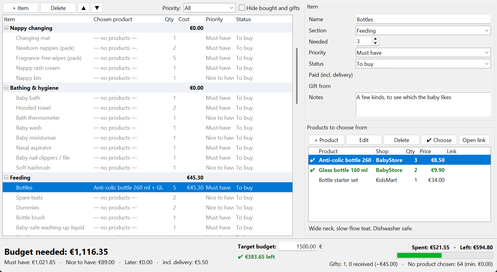

# baby-budget

A small desktop app for planning a baby shopping list with a **live budget**.
Built with Python and Tkinter, no third-party dependencies. The UI is available in Bulgarian and English, chosen when the app starts.

For every thing you need (e.g. *bottles*) you collect the products you are
choosing between, with price, shop, link and description, and pick one or more.
The budget updates as you choose.



## Features

- **Items grouped by section.** Add, delete and rename items and sections, and move both up and down. A new list starts with a ready-made sample of about 70 items in its language. *File → New list with sample items* creates another one, for a fresh start or a demo. It is based on the [NHS newborn guide](https://www.nhs.uk/start-for-life/pregnancy/preparing-for-labour-and-birth/what-to-buy-for-your-newborn-baby/) and current Bulgarian and international checklists. Items they advise against (cot bumpers, pillows) are left out.
- **Several product options per item, and more than one can be chosen.** For example, 3 Lansinoh bottles and 2 NUK. Each option has a name, price, quantity, shop, link and description. The first option you add is chosen automatically and takes the quantity you need.
- **Quantity, priority and status per item.** Priority is *must / nice / later*. Status is *to buy / bought / to be gifted / gifted*. For gifts you can note who gives them, and you can tell promised gifts apart from those already received.
- **Live budget.** Shows the total needed, a split by priority, spent vs. remaining with a progress bar, the gift count, and the minimum cost of items with no product chosen yet.
- **Target budget.** Enter the amount you want to stay within. The app shows how much is left or how far over you are, and a projection that includes the cheapest option of items not chosen yet.
- **Two languages.** At start you pick Bulgarian or English, and it stays fixed for the session. The app then opens the list you used last in that language, or creates one with the sample items in it. Each list belongs to one language. Money is shown as `1 234,50 €` in Bulgarian and `€1,234.50` in English, and exports follow the language.
- **Filters** by priority, and an option to hide bought items and gifts.
- **Export** of the final list to Markdown or CSV, one row per chosen product. The CSV opens directly in Excel: `;` and comma decimals for Bulgarian, `,` and dot decimals for English.
- **Shops and delivery.** Each product can have a shop. Each shop has a delivery cost and an optional free-delivery threshold. Delivery is added once per shop you order from, and is waived when the order reaches the threshold.
- **Real amounts.** For bought items you can enter what you actually paid (discounts, delivery). That amount replaces the planned price.
- **Auto-save and backups.** Every change goes to a JSON file right away, and writes are atomic. The last 10 versions are kept in `<name>-backups/`. A damaged file is detected on start, and you are offered the latest working backup.
- **Sharing between two people.** Put the list in a synced folder (OneDrive, Google Drive, Dropbox) with *File → Save as*. The app checks the file every few seconds and reloads changes made on the other computer. If both of you edit at the same moment, it asks which version to keep. The file opened last is remembered.

## Install

The app needs Python 3.10 or newer and nothing else.

**1. Install Python** (skip this if you already have it)

- **Windows / macOS:** download it from [python.org](https://www.python.org/downloads/) and run the installer. Tkinter, which the app uses for its window, is included.
- **Linux:** Python is usually there already. Add Tkinter and pip if they are missing, for example on Ubuntu/Debian: `sudo apt install python3-tk python3-pip`.
- **macOS with Homebrew Python:** also run `brew install python-tk`.

If something is missing, the app tells you what to install instead of failing with an error.

**2. Install the app.** Open a terminal (Windows: *PowerShell* or *Command Prompt*) and run:

| | |
|---|---|
| Windows | `py -m pip install https://github.com/borislav-boykov/baby-budget/archive/refs/heads/main.zip` |
| macOS / Linux | `python3 -m pip install https://github.com/borislav-boykov/baby-budget/archive/refs/heads/main.zip` |

Git is not needed.

**3. Start it**

| | |
|---|---|
| Windows | `pyw -m baby_budget` (`pyw` starts it without a console window) |
| macOS / Linux | `python3 -m baby_budget` |

On Windows you can make a desktop shortcut with the target `pyw -m baby_budget`.

The first time, the app asks for the language and creates a list with the sample items in your *Documents* folder (`baby-budget-bg.json` or `baby-budget-en.json`). Next time it opens the same list. Use *File → Save as* to move it, for example to OneDrive to share it.

**Update:** run the install command from step 2 again with `--upgrade` after `install`.
**Uninstall:** `py -m pip uninstall baby-budget` (macOS / Linux: `python3 -m pip uninstall baby-budget`). Your lists stay in *Documents*.

### Command-line options

```bash
python -m baby_budget                  # asks for the language, opens the last list
python -m baby_budget --lang en        # no question: English
python -m baby_budget --data list.json # a specific list file
```

A `--data` file that does not exist is created with the sample items. One that exists decides the language itself.

## Development

```bash
pip install -e ".[dev]"
ruff check .
pytest
```

| Module | Purpose |
|---|---|
| `model.py` | `ShoppingList` → `Item` → `Option` dataclasses, JSON (de)serialisation |
| `budget.py` | `summarize()` – all budget numbers, independent of the UI |
| `storage.py` | atomic JSON save, load, rotating backups, restore |
| `settings.py` | last language and last list per language |
| `export.py` | Markdown and CSV export |
| `i18n.py` | Bulgarian/English strings, money formatting and parsing |
| `gui.py` | Tkinter window |

CI (GitHub Actions) runs ruff and the tests on Python 3.10 and 3.12. The GUI tests
are skipped on runners without a display.

Your lists are plain JSON files on your own computer, or in a cloud folder you choose.
The app stores nothing else except a small `settings.json` (last language and file) in
`%APPDATA%/baby-budget`.

## License

[MIT](LICENSE) © 2026 Borislav Boykov
